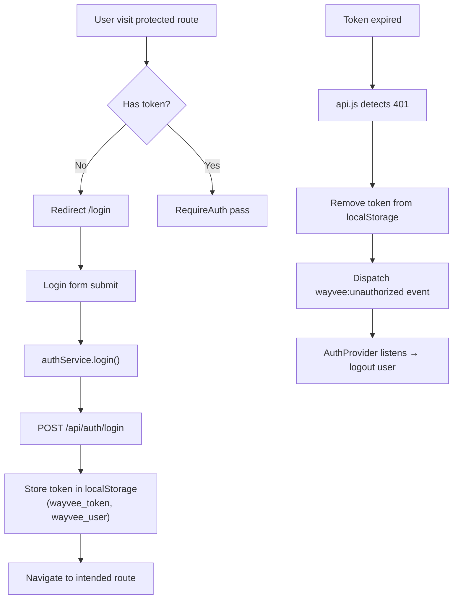
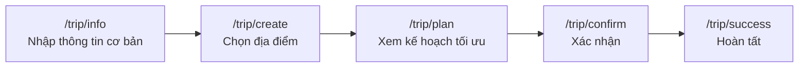

# Wayvee Frontend — Architecture

> **Mục đích file này:** Mô tả kiến trúc tổng thể, cấu trúc package, routing, và luồng dữ liệu chính của FE.  
> AI agent đọc file này thay vì dò toàn bộ source khi cần context.

---

## 1. Tổng quan

| Mục | Thông tin |
|-----|-----------|
| **Framework** | React 19 |
| **Build tool** | Vite 8 |
| **Styling** | Tailwind CSS v4 |
| **Routing** | React Router DOM v7 |
| **State** | React Context API (Auth, Theme, Layout, i18n) + localStorage |
| **HTTP Client** | Custom `fetch` wrapper (`shared/lib/api.js`) |
| **i18n** | Custom i18n provider (`locales/en`, `locales/vi`) |
| **Linting** | oxlint |
| **Testing** | Node `--test` runner |
| **Deploy** | Vercel (vercel.json) |
| **Backend URL** | `VITE_API_URL` env var |

---

## 2. Cấu trúc thư mục `src/`

```
src/
├── App.jsx                  ← Root component, routing chính
├── main.jsx                 ← Entry point, mount React app
├── index.css                ← Global CSS reset
│
├── providers/               ← React Context Providers
│   ├── app-providers.jsx    ← Gộp tất cả providers
│   ├── auth-provider.jsx    ← Auth state global
│   ├── i18n-provider.jsx    ← Ngôn ngữ (vi/en)
│   ├── layout-provider.jsx  ← Layout preferences
│   └── theme-provider.jsx   ← Dark/light mode
│
├── auth/                    ← Auth context & hook (legacy)
│   ├── AuthContext.jsx      ← React Context cho auth
│   ├── authService.js       ← Gọi API auth
│   └── useAuth.js           ← Hook useAuth()
│
├── shared/                  ← Shared utilities, UI primitives
│   ├── components/          ← Header, Footer, common components
│   ├── config/              ← site config, layout presets
│   ├── lib/                 ← api.js, cn.js, error-codes.js, storage.js
│   ├── services/            ← API calls: favorite, review, user, website-review
│   └── ui/                  ← Primitive UI: Button, Card, Badge, Input, Pill, Slider
│
├── features/                ← Feature-based modules (kiến trúc mới)
│   ├── analytics/           ← Admin analytics API
│   ├── auth/                ← Login card, Register card, auth API (feature layer)
│   ├── categories/          ← Category API
│   ├── destination/         ← Hot destinations component
│   ├── itinerary/           ← Itinerary builder, trip flow UI components
│   ├── places/              ← Places listing, filter, place detail, places API
│   ├── premium/             ← Cost estimation card
│   ├── recommendation/      ← Recommendation grid
│   └── trip/                ← Hero planner, trip review card, marketing sections
│
├── routes/                  ← Route-level components (lazy wrappers)
│   ├── home.jsx, places.jsx, place-detail.jsx
│   ├── trip-info.jsx, trip-create.jsx, trip-plan.jsx, trip-confirm.jsx, trip-success.jsx
│   ├── admin-dashboard.jsx, admin-categories.jsx, admin-reviews.jsx, admin-users.jsx, admin-revenue.jsx
│   ├── admin-guard.jsx      ← HOC bảo vệ admin routes
│   └── favorites.jsx, payment.jsx, profile.jsx, reviews.jsx
│
├── admin/                   ← Admin panel pages
│   ├── AdminDashboard.jsx
│   ├── AdminDashboardRail.jsx
│   ├── AdminCategories.jsx
│   ├── AdminRevenue.jsx
│   ├── AdminReviews.jsx
│   └── AdminUsers.jsx
│
├── homepage/                ← Trang chủ
│   ├── Home.jsx
│   └── PremiumWeather.jsx
│
├── location/                ← Chi tiết địa điểm (legacy route)
│   ├── LocationDetails.jsx
│   ├── locationData.js
│   ├── locationSuggestions.js
│   └── PremiumSuggestions.jsx
│
├── search/                  ← Trang tìm kiếm + map
│   ├── SearchPage.jsx
│   ├── SearchDialog.jsx
│   ├── SearchFilters.jsx
│   ├── SearchMap.jsx
│   ├── SearchLoading.jsx
│   └── useMapResize.js
│
├── trips/                   ← Trips (legacy)
│   ├── Trips.jsx
│   ├── TripRoutes.jsx
│   └── tripStore.js
│
├── itineraries/             ← Lịch trình đã lưu
│   └── Itineraries.jsx
│
├── favorites/               ← địa điểm yêu thích
│   └── Favorites.jsx
│
├── reviews/                 ← Reviews của user
│   ├── Reviews.jsx
│   └── WebsiteReviewModal.jsx
│
├── payment/                 ← Thanh toán Premium
│   ├── Payment.jsx          ← Trang chọn gói
│   ├── PaymentCheckout.jsx  ← Trang checkout
│   ├── PaymentSuccess.jsx   ← Trang thành công
│   ├── CheckoutDialog.jsx
│   ├── paymentService.js
│   ├── plans.js             ← Dữ liệu gói subscription
│   └── qrGenerator.js
│
├── profile/                 ← Trang profile user
│   ├── Profile.jsx
│   └── AvatarEditor.jsx
│
├── settings/                ← Cài đặt người dùng
│   ├── Settings.jsx
│   └── preferences.js
│
├── support/                 ← Hỗ trợ / Feedback
│   ├── Support.jsx
│   └── FeedbackForm.jsx
│
├── login/ register/         ← Legacy login/register pages
├── tours/                   ← Create tour (legacy, redirect về /trip/info)
├── components/              ← Layout components (Header, Footer, AccountSidebar)
├── locales/                 ← i18n: en/common.json, vi/common.json
├── assets/                  ← Images, logos
├── styles/                  ← Global styles (app.css, theme.css)
└── theme/                   ← ThemeToggle component
```

---

## 3. Routing

### Public routes (không cần auth)
| Path | Component | Mô tả |
|---|---|---|
| `/` | `Home` | Trang chủ |
| `/login` | `AccountPage` (Login) | đăng nhập |
| `/register` | `AccountPage` (Register) | đăng ký |
| `/locations/:locationId` | `LocationDetails` | Chi tiết địa điểm (legacy) |
| `/places` | `PlacesRoute` | Khám phá địa điểm |
| `/places/:id` | `PlaceDetailRoute` | Chi tiết địa điểm |
| `/search` | `SearchPage` (lazy) | Tìm kiếm + bản đồ |
| `/payment` | `Payment` | Chọn gói Premium |
| `/payment/checkout` | `PaymentCheckout` | Thanh toán |
| `/payment/success` | `PaymentSuccess` | Thanh toán thành công |
| `/support` | `Support` | Hỗ trợ |
| `/trip/info` | `TripInfoRoute` | Nhập thông tin chuyến đi |
| `/trip/create` | `TripCreateRoute` | Tạo lịch trình |
| `/trip/plan` | `TripPlanRoute` | Lên kế hoạch chi tiết |
| `/trip/confirm` | `TripConfirmRoute` | Xác nhận lịch trình |
| `/trip/success` | `TripSuccessRoute` | Hoàn tất lịch trình |

### Protected routes (cần đăng nhập — `RequireAuth`)
| Path | Component | Mô tả |
|---|---|---|
| `/profile` | `Profile` | Thông tin cá nhân |
| `/itineraries` | `Itineraries` | Lịch trình đã lưu |
| `/itineraries/:tripId` | `Itineraries` | Chi tiết trip |
| `/favorites` | `Favorites` | địa điểm yêu thích |
| `/reviews` | `Reviews` | Reviews đã viết |
| `/settings` | `Settings` | Cài đặt |

### Admin routes (cần role ADMIN — `AdminGuard`)
| Path | Component | Mô tả |
|---|---|---|
| `/admin/dashboard` | `AdminDashboard` | Dashboard tổng quan |
| `/admin/categories` | `AdminCategories` | Quản lý danh mục |
| `/admin/reviews` | `AdminReviews` | Quản lý đánh giá |
| `/admin/users` | `AdminUsers` | Quản lý người dùng |
| `/admin/revenue` | `AdminRevenue` | Báo cáo doanh thu |

---

## 4. Auth Flow



- **Token storage:** `localStorage.getItem("wayvee_token")`
- **User storage:** `localStorage.getItem("wayvee_user")`
- **Auto-logout:** `api.js` phát hiện 401 → dispatch `CustomEvent("wayvee:unauthorized")`
- **Admin check:** `role === "ADMIN"` hoặc `"ROLE_ADMIN"` trong user object

---

## 5. HTTP Client (`shared/lib/api.js`)

```js
api.get(endpoint, headers?)
api.post(endpoint, body, headers?)
api.put(endpoint, body, headers?)
api.patch(endpoint, body, headers?)
api.delete(endpoint, headers?)
```

- Base URL: `VITE_API_URL` env var
- Tự thêm `Authorization: Bearer <token>` nếu có token
- Tự thêm `Accept-Language: vi|en` theo ngôn ngữ hiện tại
- Handle lỗi: 401 → auto logout; network error → friendly message

---

## 6. State Management

| State | Nơi quản lý | Persist |
|---|---|---|
| Auth user + token | `AuthContext` / `auth-provider.jsx` | `localStorage` |
| Theme (dark/light) | `theme-provider.jsx` | `localStorage` |
| Layout preferences | `layout-provider.jsx` | `localStorage` |
| i18n language | `i18n-provider.jsx` | `localStorage` |
| Trip builder state | `tripStore.js` (module-level) | `sessionStorage` |
| Places filter state | `use-places-filter.js` hook | URL params |
| User preferences | `settings/preferences.js` | `localStorage` (per email) |

---

## 7. Features Module Chi tiết

### `features/places/`
- `pages/places-page.jsx`: Trang listing địa điểm
- `pages/place-detail-page.jsx`: Trang chi tiết địa điểm
- `components/listing/place-card.jsx`: Card địa điểm
- `components/filters/filter-panel.jsx`: Bộ lọc
- `hooks/use-places-filter.js`: Filter logic + URL sync
- `services/places-api.js`: Gọi `/api/v1/locations`
- `services/places-cache.js`: Cache kết quả tìm kiếm

### `features/itinerary/`
- `components/trip-create-page.jsx`: Nhập thông tin chuyến đi
- `components/itinerary-builder.jsx`: Kéo thả xây lịch trình
- `components/trip-plan-page.jsx`: Xem/sửa kế hoạch
- `components/trip-confirm-page.jsx`: Confirm trước khi lưu
- `components/location-map-modal.jsx`: Modal bản đồ địa điểm
- `components/trip-action-selector.jsx`: Chọn hành động trip

### `features/auth/`
- `components/login-card.jsx`: Form đăng nhập
- `components/register-card.jsx`: Form đăng ký
- `services/auth-api.js`: Gọi `/api/auth/**`

### `features/analytics/`
- `services/analytics-api.js`: Gọi `/api/analytics` (admin)

---

## 8. Shared UI Primitives (`shared/ui/`)

| Component | Mô tả |
|---|---|
| `Button` | Button với variants |
| `Card` | Card container |
| `Badge` | Badge/tag |
| `Input` | Input field |
| `Pill` | Pill/chip |
| `Slider` | Range slider |

---

## 9. Trip Creation Flow (multi-step)



State được pass qua React Router state hoặc `tripStore.js`.

---

## 10. Admin Panel

Admin guard (`routes/admin-guard.jsx`) check `user.role === ADMIN`.  
Các trang admin:
- **Dashboard**: Analytics summary (users, revenue, reviews)
- **Categories**: CRUD danh mục POI
- **Reviews**: Duyệt/xóa reviews
- **Users**: Quản lý tài khoản
- **Revenue**: Báo cáo doanh thu + payment history

---

## 11. i18n

- Ngôn ngữ: `vi` (mặc định) và `en`
- File: `locales/vi/common.json`, `locales/en/common.json`
- Provider: `i18n-provider.jsx`
- Switcher: `shared/components/language-switcher.jsx`

---

## 12. Files quan trọng để đọc nhanh

| Mục tiêu | File |
|---|---|
| Hiểu toàn bộ routing | `src/App.jsx` |
| Hiểu auth flow | `src/auth/AuthContext.jsx`, `src/providers/auth-provider.jsx` |
| Hiểu HTTP calls | `src/shared/lib/api.js` |
| Hiểu trip flow | `src/features/itinerary/components/` |
| Hiểu places listing | `src/features/places/` |
| Hiểu admin panel | `src/admin/`, `src/routes/admin-*.jsx` |
| Hiểu payment | `src/payment/` |
| Hiểu state/providers | `src/providers/` |

